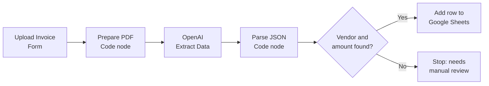

# AI Invoice Data Extractor (n8n + OpenAI)

> Manual data entry cost me hours. This workflow costs pennies.

Upload a PDF invoice and let AI do the typing. The workflow reads the invoice with OpenAI, extracts the key fields as clean JSON, and adds a new row to Google Sheets automatically.

## What it extracts

| Field | Example |
| --- | --- |
| Vendor | Acme Supplies Ltd |
| Invoice Number | INV-0042 |
| Invoice Date | 2026-10-12 (YYYY-MM-DD) |
| Currency | USD |
| Total Amount | 1250.00 |

## How it works



1. **Upload Invoice (Form):** an n8n form where you upload a PDF.
2. **Prepare PDF for OpenAI:** converts the PDF to base64 and builds the request.
3. **OpenAI Extract Data:** sends the PDF to `gpt-4o-mini` and gets structured JSON back using a strict JSON schema.
4. **Parse OpenAI JSON:** cleans the response into one tidy row.
5. **Vendor and Amount Found?:** if either is missing, the workflow stops with an error so bad data never reaches your sheet.
6. **Add Row to Google Sheets:** appends the row.

## Tech stack

- [n8n](https://n8n.io) for workflow automation
- [OpenAI API](https://platform.openai.com) (`gpt-4o-mini` by default)
- Google Sheets

## Setup

1. In n8n, go to **Workflows**, then **Import from File**, and choose `ai_invoice_extractor_n8n_openai.json`.
2. Open the **OpenAI Extract Data** node and select (or create) your **OpenAI API** credential.
3. Open the **Add Row to Google Sheets** node, connect your Google account, and paste your Sheet ID.
4. In row 1 of the sheet, add these headers exactly:

   ```
   Date Processed | File Name | Vendor | Invoice Number | Invoice Date | Currency | Total Amount
   ```

5. Click **Test workflow**, open the form, and upload a PDF invoice.

## Customize

- **Better accuracy on messy or scanned invoices:** change `model` in the *Prepare PDF for OpenAI* code node to `gpt-4o` or `gpt-4.1`.
- **Extra fields:** add them to the prompt and the JSON schema in the same code node, then add matching columns in the sheet.
- **Next steps:** send a Slack or email alert, save the PDF to Google Drive, push data to QuickBooks or Xero, or flag duplicate invoice numbers.

## Notes

- Works best with text-based PDFs. Very blurry scans may need a stronger model.
- Review the extracted data before using it for accounting or payments.
- Never commit API keys or credentials. n8n stores them securely in its credentials manager, and the exported workflow contains only placeholders.

## Author

**Mujahid Hussain** | Full Stack AI Engineer

Building AI agents, voice agents, and automations for real businesses. Want something like this for your business? Reach out on [LinkedIn](https://www.linkedin.com/) or via Upwork.

## License

MIT
